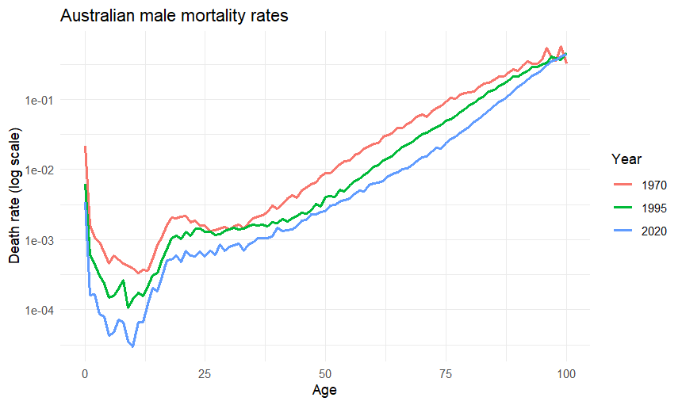
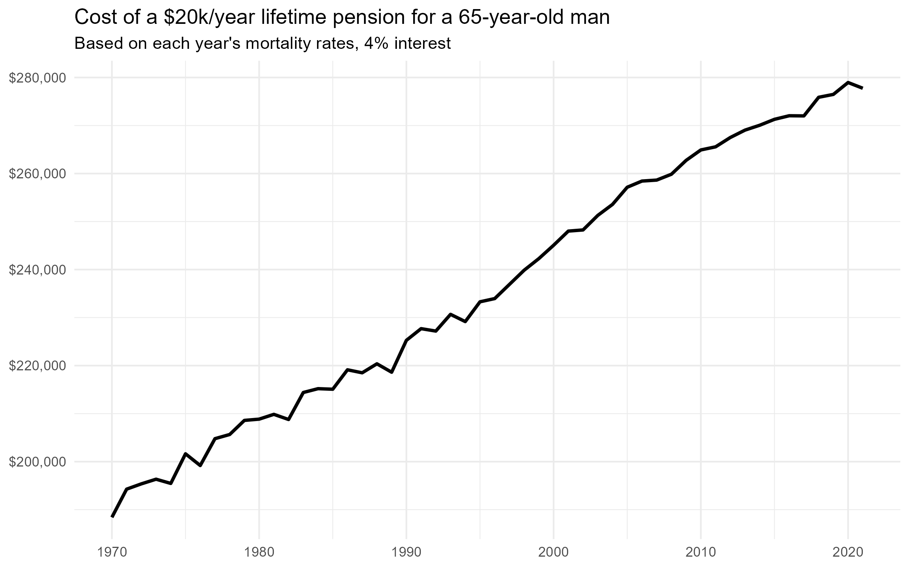

# Australian Mortality & Life Insurance Pricing

How much longer are Australians living, and what does that do to the cost of retirement and life insurance?

This project builds life tables from raw Australian mortality data (1970–2021), fits a Gompertz mortality model, and uses the results to price a lifetime pension and a term life insurance policy.

**Tools:** R (tidyverse, ggplot2)
**Data:** [Human Mortality Database](https://www.mortality.org), Australia, age-specific death rates (1x1)

---

## Key findings

1. **Life expectancy has risen sharply.** Male life expectancy at birth rose from 67.4 years (1970) to 81.6 (2020). Females rose from 74.2 to 85.7, and the gender gap narrowed from 6.8 years to 4.1.
2. **Retirement is much longer.** A 65-year-old man in 2020 could expect 20.6 more years of life, up from 12.0 in 1970: 72% more time in retirement.
3. **Mortality doubles every ~8 years of adult age.** A Gompertz model fitted to 2020 male mortality (ages 30–90) gives c = 1.092 with R² = 0.987, meaning the chance of dying rises ~9% per year of age.
4. **Longer lives make pensions far more expensive.** Funding a $20,000/year lifetime pension for a 65-year-old man cost $188,400 under 1970 mortality vs $278,954 under 2020 mortality (4% interest). That is a 48% increase driven purely by longevity.

---

## Method

### 1. Mortality trends
Compared age-specific death rates for 1970, 1995 and 2020. Infant mortality fell sharply, the young-male "accident hump" (ages ~17–25) flattened, and adult mortality falls on a near-straight line on a log scale.

### 2. Life tables
Built period life tables from scratch for every year and sex since 1970:
- converted death rates (mₓ) to probabilities of death: qₓ = mₓ / (1 + 0.5mₓ)
- derived survivors (lₓ), deaths (dₓ), person-years lived (Lₓ, Tₓ) and life expectancy (eₓ = Tₓ / lₓ)

Results were checked against HMD's official life tables.

### 3. Gompertz model
Fitted μₓ = Bcˣ by linear regression on log death rates (2020 males, ages 30–90): B = 3.63×10⁻⁵, c = 1.092.

The model fits ages 30–85 well but **underestimates mortality below 35** (accidents are not age-driven) and **above 90**. Using it to price annuities would overstate survival at the oldest ages and overprice the product.

### 4. Pricing (2020 male mortality)

| Interest rate | Annuity factor (age 65) | Cost of $20k/yr pension | Annual premium: $500k, 20-yr term, age 40 |
|---|---|---|---|
| 2% | 16.9 | $338,154 | $1,340 |
| 4% | 13.9 | $278,954 | $1,248 |
| 6% | 11.8 | $235,658 | $1,165 |

Moving from 2% to 6% interest cuts the pension cost by **30%** but the term premium by only **13%**. The annuity's cash flows stretch over 30+ years (longer duration), so it is far more sensitive to interest rates.

---

## Limitations
- **Period life tables** use a single year's death rates and ignore future mortality improvement, so true pension costs are likely higher than shown.
- Premiums are **net (pure risk) premiums**: no expenses, profit margin or underwriting.
- Population mortality is used. Insured lives are typically healthier than the general population.
- Deaths assumed to occur mid-year (including at age 0, where infant deaths actually cluster early in the year).

---

## How to run
1. Register (free) at [mortality.org](https://www.mortality.org) and download Australia → Period data → Age-Specific Death Rates → **1x1** (`Mx_1x1.txt`), plus the Males and Females **1x1 life tables** (`mltper_1x1.txt`, `fltper_1x1.txt`).
2. Place the files in the project folder.
3. Open `analysis.R` in RStudio and run it.

Data is not included in this repository, in line with the Human Mortality Database user agreement.
